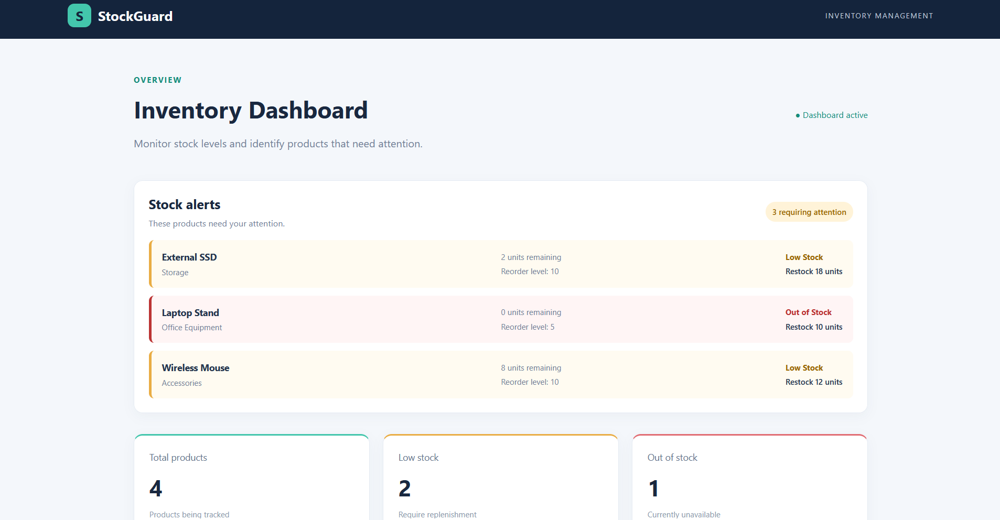
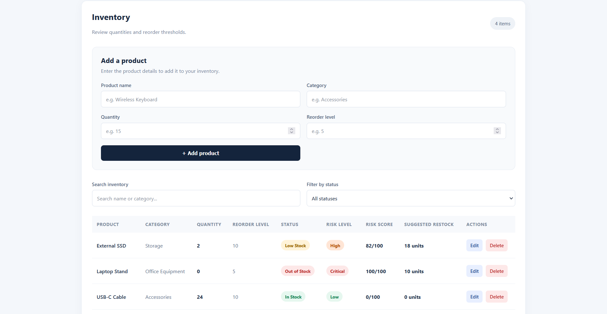

# StockGuard

**StockGuard** is an inventory management and stock-risk monitoring web application built with Python and Flask. It helps users manage inventory, identify products that need replenishment, and calculate rule-based stock risk scores and suggested restock quantities.

**Live Demo:** [Open StockGuard](https://stockguard-si.onrender.com/)

**Source Code:** [GitHub Repository](https://github.com/SiyaK0312/StockGuard)

## Dashboard Preview





## Features

- **Inventory dashboard:** View products, inventory totals, low-stock counts, and out-of-stock counts.
- **Product management:** Add, edit, and delete inventory records.
- **SQLite database:** Store product names, categories, quantities, and reorder levels.
- **Stock status monitoring:** Classify products as In Stock, Low Stock, or Out of Stock.
- **Risk scoring:** Calculate a risk score from 0 to 100 using predefined stock-level rules.
- **Risk classification:** Assign Low, Moderate, High, or Critical risk levels.
- **Restock recommendations:** Calculate suggested replenishment quantities based on target stock levels.
- **Stock alerts:** Highlight products that need attention.
- **Search and filtering:** Search by product name or category and filter by stock status.
- **Input validation:** Reject invalid quantities and missing required fields, with user-friendly feedback.
- **Automated testing:** Test important routes, inventory operations, and validation behaviour.

## Technology Stack

- Python
- Flask
- SQLite
- HTML
- CSS
- JavaScript
- Jinja templates
- Gunicorn
- Python `unittest`
- Git and GitHub
- Render

## How Stock Risk Is Calculated

StockGuard uses transparent, rule-based calculations rather than a machine-learning model.

- **In Stock:** Quantity is greater than the reorder level. The risk score is 0.
- **Low Stock:** Quantity is above zero but at or below the reorder level. The risk score increases as the available quantity falls further below the threshold.
- **Out of Stock:** Quantity is zero. The risk score is 100 and the risk level is Critical.

For low-stock products, the score is calculated from the difference between the current quantity and reorder level. Scores of 60 or above are classified as High; lower low-stock scores are classified as Moderate.

Suggested restock quantities use a target of twice the reorder level, with a minimum target of one unit above the reorder level. The recommendation is the difference between this target and the current quantity, or zero if no replenishment is needed.

These rules are illustrative and can be extended with sales history, demand forecasting, and supplier lead times.

## Getting Started

### Prerequisites

- Python 3
- Git

### Installation

Clone the repository and enter the project directory:

```bash
git clone https://github.com/SiyaK0312/StockGuard.git
cd StockGuard
```

Create and activate a virtual environment on Windows PowerShell:

```powershell
py -m venv .venv
.\.venv\Scripts\Activate.ps1
```

Install the dependencies:

```powershell
py -m pip install -r requirements.txt
```

### Run Locally

Start the application:

```powershell
py app.py
```

Open [http://127.0.0.1:5000](http://127.0.0.1:5000) in your browser.

StockGuard creates its SQLite database and adds demonstration products when the database is empty.

### Run the Automated Tests

Run the test suite from the project directory:

```powershell
py -m unittest -v test_app
```

The test suite uses a temporary database so that tests do not need to modify the local inventory database.

## Deployment

StockGuard is deployed as a Flask web service on Render.

The hosted demo uses Gunicorn and the `wsgi.py` entry point. The deployment configuration is maintained separately from the local development command.

**Demo limitations:** The free Render web service may spin down after inactivity, so the first request after a period of inactivity may take longer to respond. Its filesystem is ephemeral, meaning the local SQLite database can be reset after a restart, spin-down, or redeployment. This deployment is intended for portfolio demonstration, not for storing real or sensitive inventory data.

For persistent hosted inventory, the application would need a suitable persistent database configuration, such as a managed PostgreSQL database.

See the [Render documentation on free instances](https://render.com/docs/free) for further details.

## Project Structure

```text
StockGuard/
├── screenshots/
│   ├── stockguard-dashboard.png
│   └── stockguard-dashboard2.png
├── static/
│   └── style.css
├── templates/
│   ├── base.html
│   ├── dashboard.html
│   ├── edit_product.html
│   └── index.html
├── .gitignore
├── app.py
├── requirements.txt
├── test_app.py
├── wsgi.py
└── README.md
```

## What This Project Demonstrates

StockGuard demonstrates practical experience with Python web development, Flask routing, relational database operations, server-side validation, dynamic HTML templates, client-side search and filtering, rule-based business logic, automated testing, Git version control, and web deployment.

It is a portfolio project designed to demonstrate the development of a working application from local implementation through testing and deployment.

## Future Improvements

Potential improvements include persistent hosted database storage, user authentication and role-based permissions, stock movement history, configurable risk rules, and more advanced inventory analytics.
